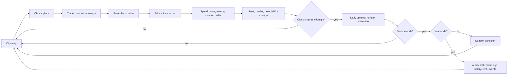

# NeonLife — Design & Build Plan

NeonLife is a BitLife-style life simulator set in a neon-soaked sprawl. You live
one life in a compressed calendar: take actions hour by hour, keep yourself fed
and rested, and let the seasons carry you into the next year. The tone is noir
with chrome — corporate cruelty, street hustle, cheap noodles, expensive
upgrades.

The game is GUI-first. The player should never type a command; every verb is a
button inside a themed interface. The central verb is **going somewhere**: the
city is a map, locations have hours and services, and the actions available to
you depend on where you are and what time it is.

> **Universe note.** NeonLife is an original setting. It is not *Cyberpunk
> 2077*, *Cyberpunk RED*, or any other licensed universe. District names, slang,
> factions, and brands must be original. See §11 for the naming guardrails.

---

## 1. Design pillars

1. **Time is the budget.** Aging is automatic. Every action spends hours, and
   the clock keeps running even when you are idle. A 28-day year keeps the
   lifecycle legible without grinding 360 days.
2. **The city is the menu.** Body, Work, Education, etc. are not global lists of
   buttons. Each is a screen of opportunities, and most opportunities are tied
   to a place and a time window.
3. **Travel has weight.** Going somewhere costs minutes and energy. A good night
   out can strand you across town with no bed and no money for a room.
4. **People are systems.** NPCs remember how you treat them, decay if ignored,
   and generate opportunities and trouble.
5. **The city pushes back.** Crime raises heat, chrome costs health, ambition
   costs energy, and rent is always due.
6. **Readable numbers, unpredictable stories.** Stats are legible (0–100,
   credits, heat), but events and outcomes are rolled.

---

## 2. Core loop



A turn is measured in hours, not actions. Energy and credits are the hard
budgets; time is the soft one. Sleep and wait use the same duration dialog:
hours, minutes, and seconds, with presets.

---

## 3. Screen layout

```
┌───────────────┬───────────────────────────────────────────────┬───────────────┐
│  LEFT SIDEBAR │                 MAIN CONTAINER                │ RIGHT SIDEBAR │
│               │                                               │               │
│  Dossier      │  Clock bar: season · time · location · buttons│  Network      │
│  Vitals       │                                               │  (contacts)   │
│  Wallet       │  ┌─────────────────────────────────────────┐  │               │
│  Status       │  │              CITY MAP                  │  │  Heat         │
│               │  │   drag to pan · click a place           │  │               │
│               │  │   floating log / interface dialogs      │  │               │
│               │  └─────────────────────────────────────────┘  │               │
│               │  ┌─────────┐  ┌───────────────────────────┐   │               │
│               │  │ Portrait│  │ Core stats                │   │               │
│               │  │         │  │                           │   │               │
│               │  └─────────┘  └───────────────────────────┘   │               │
│               │  [5 personal options]    [5 world options]    │               │
└───────────────┴───────────────────────────────────────────────┴───────────────┘
```

### Left sidebar — Dossier

Identity (name, pronouns, age, occupation), vitals bars, credits, heat, current
home, current location, origin district, and a derived condition ("Stable",
"Burnt out", "Critical", "Hunted").

### Center — City map / location view

The center is a map-first stage, not a feed. It has two modes:

- **City map** (default, always behind everything else): a pannable SVG map.
  Drag the map to look around, use the zoom controls, and click a place to open
  a floating card with its district, address, hours, services, district facts,
  route time, energy cost, and a TRAVEL button. Once the player is at the
  selected place, the card offers ENTER.
- **Location view**: replaces the map when the player enters a place. It shows
  the address, open state, description, services, and every non-hidden action
  tied to that address across all interfaces (for example, both Bath House
  Shower and Sauna). At Home it embeds the residence, furniture slots, and
  property market. A back button returns to the map.

Interface panels no longer replace the map permanently. They open as a floating
layer over the current stage, with a dimmed backdrop and a close button. The
**Life Log** is a floating dialog opened from the clock bar's LOG button, and
**Inventory** is a compact floating dialog.

A persistent **clock bar** sits above the stage. It shows the season, day of
season, year, 24-hour time with seconds, day progress, current location, age
countdown, and hunger warning. The location chip closes any open panel and
returns to the map. SLEEP, WAIT, and LOG live on the right.

### Right sidebar — Network

Live contact list with relationship meters and last dialogue line. Clicking a
contact jumps to the Social interface. Below it, a heat readout and a short
contextual tip.

### Option buttons (10)

The map is never a button: it is the stage. Interface buttons now open floating
panels over it.

| Side  | # | Interface  | Verb                          | Primary resources        |
| ----- | - | ---------- | ----------------------------- | ------------------------ |
| Left  | 1 | Body       | Condition, food, and chems    | credits, health, satiety |
| Left  | 2 | Education  | Learn new skills              | credits, energy, smarts  |
| Left  | 3 | Work       | Chase credits                 | energy, smarts, salary   |
| Left  | 4 | Social     | People are leverage           | credits, energy, NPCs    |
| Left  | 5 | Leisure    | Spend your off-hours          | credits, energy          |
| Right | 6 | Inventory  | Supplies, gear, and chrome    | credits                  |
| Right | 7 | Finance    | Track the flow                | credits, heat            |
| Right | 8 | Underworld | High risk, high cred          | health, heat, cred       |
| Right | 9 | Home       | Your residence                | credits, rent            |
| Right |10 | System     | Options and saves             | —                        |

Location-bound actions are no longer reachable from a global list. Entering an
address is the way to see what can be done there. The interface panels remain
for cross-location tools: buying supplies, managing property, checking contacts,
and reviewing finances.

Assets and cyberware are no longer top-level buttons. They live as **Gear** and
**Chrome** tabs inside Inventory. This keeps the option bar focused on verbs, not
item categories.

---

## 4. Interface catalog

### 4.1 Body

The body economy and the future anatomy layer.

- Street food and chem counter with a carried pantry. Supplies are bought at the
  Night Market or Chop Shop, or ordered to Home.
- Street-surgeon patch-up, trauma therapy, stim drip, detox. Clinic actions are
  only available at the Undercity Clinic.
- Stims trade long-term health for immediate energy — the core risk/reward.
- Sleep lives in the clock bar, not this screen.
- **Planned anatomy layer:** body parts (head, torso, arms, legs) and organs
  (heart, lungs, liver, kidneys, nervous system) each with condition and
  targeted injuries. Clinics will treat specific systems; chrome will occupy
  slots and interact with parts.

### 4.2 Education

Permanent stat growth with a time/credit cost.

- Datapad study at Home or the Gridhouse (cheap, slow).
- Gridrunning bootcamp and Meridian Polytechnic at the Gridhouse.
- Corporate certification at Consortium Plaza.
- Streetwise course at the Night Market.
- Future: prerequisites, multi-year course progress, student debt, degree-gated
  job trees.

### 4.3 Work

Income and identity. Jobs have a title and a yearly salary; gigs pay once.

- Freelance gig and shift work at Union Hall.
- Promotion and corporate application at Consortium Plaza.
- Street hustle at the Night Market.
- Promotion can fail and costs happiness; corporate jobs require smarts.
- Future: job ladders, performance reviews, layoffs, coworkers as NPCs, side
  businesses.

### 4.4 Social

The NPC interface. Lists every contact with relationship score, role, district,
trait, and last line.

- Message (cheap), hang out (credits + energy), gift (credits), date (requires
  relationship ≥ 40).
- Relationship decays each year; ignored contacts drift away.
- Future: location-aware meetings, romance, rivalry, betrayal, favors,
  introductions, faction standing.

### 4.5 Leisure

Low-stakes stat recovery and flavor. Activities are location-gated.

- Club night and companion rental on the Neon Strip.
- Memory reels on the Neon Strip.
- Street gym at Union Hall.
- Noodle bar at the Night Market.
- Orbital weekend at Consortium Plaza (once per year).
- Success/failure is mostly cosmetic; the real cost is opportunity.

### 4.6 Map

The navigation screen and the new center of the world.

- Interactive district map with 11 venues plus a movable Home node.
- Click a node to inspect it: district, description, services, opening hours,
  route time, energy cost, and intermediate stops.
- Travel time follows straight-line distance on the map, not a hand-authored
  timer. Moving house changes the Home node and therefore the routes.
- Every detail panel shows concrete facts: address, services, employers,
  housing, and opening hours. No authored tier score is used.
- Travel is a shortest-path route over the city graph. The map highlights the
  route and shows the via-stops.
- Closed locations can still be visited, but their services are unavailable.
- Travel is never blocked by low energy, so the player can always crawl home.
- The clock bar location chip and Home screen both jump here.

### 4.7 Inventory

Everything the player carries, in three tabs.

- **Supplies** — food, coffee, stims, and med-gel. Buy at Night Market / Chop
  Shop, or order to Home; use anywhere.
- **Gear** — weapons, vehicles, armor, drones. Bought at the Chop Shop.
- **Chrome** — neural links, optics, cyberarms, subdermal armor. Installed at
  the Chop Shop or Undercity Clinic.
- Owned items are marked and cannot be bought twice.
- Future: weight/capacity, storage at Home, item condition, resale.

### 4.8 Finance

A read-only summary plus money actions.

- Balance, yearly salary, rent or upkeep, equity, net cash flow, heat,
  transaction ledger.
- Scrub your trace (remote), invest in a fixer's scheme (The Spine, night only).
- Future: loans, debt, credit score, investments, rental income, taxes.

### 4.9 Underworld

High-variance moneymaking. Success pays; failure costs health, credits, or heat.

- Pickpocket at the Night Market or Neon Strip.
- Data heist at the Gridhouse.
- Corporate infiltration at Consortium Plaza after hours.
- Bounty at The Spine.
- Lay low at Home or the No-Tell Motel.
- Bribe a cop at the Night Market or The Spine.
- Heat (0–5) gates risky actions and drives future events.

### 4.10 Home

Real estate is a set of units in real buildings. Location matters because of the
building, its amenities, nearby services, jobs, and travel times — not an
authored neighborhood tier.

- Home is a set of **furniture slots** plus the objects installed in them.
- Installing a bed unlocks sleep; a chair unlocks rest; a shower unlocks
  showering; a work deck unlocks study; a cold locker unlocks meal prep; a
  wardrobe unlocks dressing.
- Objects are used by interacting with them, not by a separate global menu.
- Rent (deposit, yearly rent) or buy (purchase price, yearly upkeep, equity).
- The active property places your Home node on the city map.
- Selling an owned property returns 80% of its price; rental deposits are
  refunded when you move out.
- Home is always open. Without a bed, sleeping at home is impossible.
- Planned: real apartment units, landlords, vacancy, roommates, eviction.

### 4.11 System

Meta controls.

- Theme selector (Catppuccin Mocha, Macchiato, Frappé, Latte).
- Start a new life (destructive, confirmed).
- Planned: manual save/load, autosave, audio, keybinds, accessibility, credits.

---

## 5. Simulation model

### Player state

| Field        | Range / type                  | Notes                                   |
| ------------ | ----------------------------- | --------------------------------------- |
| name         | string                        | Generated or chosen on new life         |
| age          | 16–?                          | Increases when the calendar year closes |
| pronouns     | string                        | Flavor                                  |
| district     | string                        | Origin district, not current location   |
| occupation   | string                        | "Unemployed" until hired                |
| salary       | credits / year                | Paid at year-end                        |
| credits      | integer ≥ 0                   | Spent and earned                        |
| wanted       | 0–5                           | Raised by crime, lowered by time/bribes |
| health       | 0–100                         | Systemic condition; 0 = death (planned) |
| happiness    | 0–100                         | Low happiness drives bad events         |
| energy       | 0–100                         | Action budget; sleep restores           |
| satiety      | 0–100                         | Food need; drains with the clock        |
| hygiene      | 0–100                         | Shower/rest need; low hygiene hurts mood |
| location     | location id                   | Current venue, or Home (moves with your property) |
| home         | property id                   | Active residence; places the Home node on the map |
| tenure       | rent / own                    | Rent paid yearly, or upkeep plus equity if owned |
| smarts       | 0–100                         | Education and job gates                 |
| looks        | 0–100                         | Social and leisure flavor               |
| streetCred   | 0–100                         | Crime/cyberware gates                   |

### Calendar, time, and needs

Time is the primary budget, not age.

- **Day** — 24 hours, tracked in seconds. The player starts at 07:00:00.
- **Season** — 7 days: Bloom → Surge → Rust → Frost.
- **Year** — 4 seasons = **28 days**. Aging, salary, and rent settle at the end
  of Frost 7.

Why 28 days: a year still has four recognizable seasons and a meaningful
year-end settlement, but the player reaches the next age in a few sessions
instead of grinding 360 days. The calendar is a colony-sim-style compression,
not a literal Earth year.

**Satiety** drains at 3 points per hour awake and 1.2 per hour asleep. At dawn:

- below 20: lose 1 happiness;
- at 0: lose 5 health and 3 happiness.

**Hygiene** drains at 1.5 points per hour awake and 0.8 asleep. At dawn, below
15 costs 1 happiness; at 0 it costs 3. Showers restore it. A home without a
shower forces the player to use a bath house (paid) or stay dirty.

**Sleep** is chosen in a duration dialog with hour/minute/second inputs and
presets (15M / 30M / 1H / 4H / 8H). It is only available at a hotel or by
interacting with a bed at home. The bed, not the building, sets recovery:
energy per hour, happiness on waking, and whether six hours grants +1 health.
Sleeping below 20 satiety cuts recovery to 60%.

**Rest** is a separate object interaction. Sitting on a chair or couch opens a
duration dialog and restores energy at that item's rate (1.5–4.5 EN/hour)
without the full benefits of sleep. Waiting while standing is always available
but costs **3 EN/hour**. The player chooses between standing wait and resting
on a real seat.

**Wait** is available anywhere and costs 3 energy per hour while standing. It is
the fallback when there is no bed or seat, when the player wants to reach an
exact time, or when they are stranded between venues. Waiting never blocks
travel, so the player cannot be stuck. The distinction is deliberate: sleep and
rest are restorative and require the right object; standing wait is flexible and
drains you.

**Consumables** are bought into a pantry and used from anywhere. Each has a
price, a time cost, and stat effects. Food restores satiety; coffee and stims
restore energy, with stims costing health. Buying and using both advance the
clock.

### World map, districts, and travel

The city is a weighted graph. Locations are nodes; streets are edges. The map
is **hand-authored**, never generated: every node, address, edge, and property
lives in `src/game/world.ts` (see `docs/world-building.md`). **Travel time is
derived from map distance** (`0.05` minutes per map unit, minimum 2), so moving
a node changes every route that touches it.

Home is not a fixed node. It is placed at the coordinates of the active
property, and connects to the three nearest venues. Routes between venues never
travel *through* Home; it is a destination, not a shortcut. Changing residence
therefore changes the player's travel times to work, clinics, and nightlife.

Neighborhood quality is **emergent, not authored**. There is no tier, service
score, job multiplier, or safety stat. Quality comes from the actual buildings,
businesses, job slots, wages, residents, safety, and travel access in that
district. The map may show a computed summary, but it is read-only and derived
from real entities.

Until buildings and jobs exist, the UI shows only concrete facts it can prove:
the district's places, its actual service list, and its real rent range. See
`docs/simulation-plan.md`.

| Location         | District        | Services                          | Hours     |
| ---------------- | --------------- | --------------------------------- | --------- |
| Home             | *active property* | Rest, Storage, Study, Supplies  | 24H       |
| Capsule Annex    | Lantern District| Rest, Shower                      | 24H       |
| No-Tell Motel    | Salt Flats      | Rest, Discretion                  | 24H       |
| Kestrel Bath House | Kestrel Row  | Bath, Sauna                       | 06–23     |
| Night Market     | Marrow Market   | Food, Leisure, Social, Underworld | 18–04     |
| Consortium Plaza | Glass Spire     | Work, Education, Finance          | 07–20     |
| Undercity Clinic | Undercity       | Body, Chrome                      | 24H       |
| Neon Strip       | Violet Mile     | Leisure, Social, Underworld       | 20–05     |
| Gridhouse        | Signal Yard     | Education, Gridrunning            | 07–02     |
| Union Hall       | Iron Union      | Work, Gym                         | 05–21     |
| Chop Shop        | Chop Row        | Gear, Chrome, Supplies            | 10–03     |
| The Spine        | The Spine       | Underworld, Fixers, Bounties      | 20–06     |

Travel energy is `ceil(minutes / 12)`, with a minimum of 1. Travel is never
blocked; arriving exhausted is legal. The log records the route, time, and
energy spent, including the via-stops.

### Housing, neighborhoods, and real estate

Properties are real estate on the map, not a global housing ladder.

- Each property belongs to a neighborhood and supplies the Home node's position.
- Every property has a yearly **rent** and a one-time **purchase price**.
- Renting costs a **deposit**, refunded when moving out; the deposit is the
  move-in cost.
- Buying removes rent, but charges yearly **upkeep** (roughly 1.5% of price).
  Owned property counts as equity in Finance.
- Selling an owned home returns 80% of its purchase price.
- A property's one-time stat bonus is granted once per year, so move-in bonuses
  cannot be farmed by bouncing between addresses.

Eleven property listings currently stand in for the first building stock. Their
rent, price, rest, and upkeep are authored placeholders; the target model derives
these from the unit and building (size, condition, amenities, access, demand).
Cheap homes are cheap because the building and unit are worse, not because the
district has a low tier.

### World hierarchy

Places are authored in one catalog, `src/game/world.ts`:

```
Nation → State → City → District → Address / Place
                                   Address / Property listing
```

Current content ships one nation (Meridian Compact), one state (Lantern Reach),
and one city (Vesper). Districts currently carry temporary quality placeholders
and a map label. Places carry a street address, opening hours, services, and a
map node. Properties carry both a street address and the map position used for
the player's Home node.

The living-world layer adds:

```
Building → Unit → Household / Business → JobSlot → Person
Corporation → owns Buildings, operates Businesses
Lineage → Family → Person
```

Buildings, corporations, businesses, job slots, NPCs, families, and lineage are
specified in `docs/simulation-plan.md`. The principle is that every job has a
real workplace address, every NPC has a real home, and neighborhood quality is
computed from those facts.

Country-level travel is a planned layer, not a rewrite: add cities and their
local maps/edges, put `activeCityId` in the store, then add an intercity network
with minutes, fares, and border requirements. See `docs/world-building.md`.

### Location-gated actions

Every action may declare:

- `at`: a list of location ids where it can be performed. Omitted means anywhere.
- `hours`: an opening window in 24-hour time. Omitted means any time.

An action is blocked when:

1. the current location is not in `at`;
2. the current location is closed;
3. the action's own time window does not include the current time;
4. the player lacks credits or energy;
5. stat/employment/heat requirements are not met.

Action cards show location and hour tags, and the action list is split into
**Available here** and **Elsewhere**. "Elsewhere" cards remain visible so the
player can see what the city offers and where to go, but they cannot be run.

### Vendors

Shopping is location-aware and driven by each place's authored `services` list:

- **Supplies** — places with the `Supplies` service (Night Market, Chop Shop,
  and Home delivery).
- **Gear** — places with `Gear` (Chop Shop).
- **Chrome** — places with `Chrome` (Chop Shop or Undercity Clinic).

Using a consumable is allowed anywhere. This makes stocking up a reason to
travel, without making hunger impossible to solve. Adding or removing a service
in `world.ts` changes vendor availability without a store edit.

### Body model (next layer)

The current `health` stat is systemic. The planned anatomy layer adds:

```ts
type BodyPart = {
  id: "head" | "torso" | "leftArm" | "rightArm" | "leftLeg" | "rightLeg";
  condition: number; // 0–100
  injury?: string;
};

type Organ = {
  id: "heart" | "lungs" | "liver" | "kidneys" | "nervousSystem";
  condition: number; // 0–100
  condition_tag?: string;
};
```

Design rules:

- Health is the average of major systems, so existing content keeps working.
- Injuries target a part or organ; the clinic screen lists what can be treated.
- Cyberware occupies a part/slot and can raise or lower that part's condition.
- Death is checked at the systemic level, not per part.
- The UI will be a body schematic with selectable regions, not a longer stat bar.

### Action resolution

1. Check location and opening hours.
2. Check requirements (credits, stat minimums, employment, heat).
3. Check energy and credit costs.
4. Apply costs and guaranteed effects.
5. If the action has outcomes, roll one weighted outcome.
6. Apply outcome effects, clamp stats to 0–100, clamp heat to 0–5.
7. Append a log entry and, for money, a ledger entry.
8. Advance the clock by `time` (default 1 hour) in seconds. This may trigger
   midnight upkeep, a season transition, or a yearly settlement.

### Yearly settlement (end of Frost)

1. `age += 1`.
2. Health decay after 35 and steeper after 55.
3. Pay salary (if employed), then charge rent or owned-property upkeep.
4. Decay every NPC relationship by 2.
5. Roll a procedural life event (about 75% chance).
6. Chance to meet a new NPC.
7. Clear once-per-year action locks.
8. Log a year summary.

### Balance targets (v1)

- Starting credits: 2,500. Starting stats in the 45–90 band, satiety 70–90,
  hygiene 60–85.
- A full waking day costs about 35–50 satiety and 40–80 energy. Sleep restores
  energy proportionally to duration; food restores 30–60 satiety.
- Hotel sleep: ¥8/hour (Capsule Annex) or ¥18/hour (No-Tell Motel), with
  recovery scaled by the hotel's own quality. Standing wait drains 3 energy per
  hour; chair rest restores 1.5–4.5 per hour.
- Bath house shower: ¥25. Sauna: ¥45. Owning a shower at home removes the fee.
- Starting home: Capsule Stack, 4 furniture slots, with a Foam Mat installed.
- Gigs: 350–850. Corporate salary is a temporary authored value until real job
  slots exist.
- A reckless player should feel hunger, grime, and rent within 2–3 years.
- A careful player should afford the first cyberware upgrade around year 4–6.

---

## 6. NPC system

### Data model

Current prototype (contact card):

```ts
type Npc = {
  id: number;
  name: string;        // generated from pools
  role: string;        // Fixer, Gridrunner, Chopdoc, ...
  district: string;
  trait: string;       // loyal, greedy, paranoid, ...
  relationship: number; // 0–100
  lastLine: string;    // most recent dialogue
};
```

Target living-world model: every contact is a full `Person` with a family,
household, home unit, employer, job slot, schedule, and lineage. See
`docs/simulation-plan.md` for the full schema.

### Relationship bands

| Score  | Band        | Behavior                                  |
| ------ | ----------- | ----------------------------------------- |
| 0–19   | Cold        | May ignore messages; can drop off the list|
| 20–39  | Acquainted  | Small talk, minor favors                  |
| 40–59  | Friendly    | Dates, discounts, gig referrals           |
| 60–79  | Close       | Favors, backup, introductions             |
| 80–100 | Ride or die | High-value help, risk of betrayal later   |

### Generation

Names, handles, roles, districts, and traits are sampled from themed pools.
Relationship starts at 20–55. Each interaction changes the score, updates the
last line, and may change the trait-derived reply.

### Planned depth

- Full `Person` records: family, household, home address, employer, schedule.
- Memory of recent interactions (gift spam has diminishing returns).
- Family and lineage: parents, children, siblings, partners, inheritance.
- NPCs compete for the same real job slots as the player.
- Faction tags and rivalries.
- NPC-driven events (a friend asks for a loan; a fixer offers a contract).
- Location-aware meetings at real addresses.
- Romance and breakup arcs, jealousy, betrayal at high stakes.
- NPC aging, death, and family migration, with log entries and mood effects.

---

## 7. Procedural events

v1 uses a **weighted deck** gated by age, heat, and employment. Each event has
text, tone, and stat/credit/heat effects. The deck is intentionally small and
readable; the system is built to grow.

Planned layers:

1. **Ambient events** — flavor, small stat changes (current v1).
2. **Consequences** — follow-ups to player actions (crime heat, cyberware health).
3. **Contracts** — multi-year jobs with stages and NPC contacts.
4. **Arcs** — romance, addiction, corporate rise/fall, revenge.
5. **World events** — district crackdowns, market crashes, gang wars.
6. **Economic events** — a business opens, closes, hires, or poaches; a
   corporation moves its headquarters; rents spike or collapse.
7. **Family events** — births, marriages, inheritance, eviction, a relative
   asking for help, a lineage scandal.

Randomness should be injectable (seeded RNG) so outcomes and balance can be
tested deterministically. Future events can also be location-gated: a market
crash only fires while the player is in the Night Market, a crackdown only on
the Neon Strip.

---

## 8. Technical architecture

### Stack

Tauri 2 + Vite 8 + TypeScript + [Ripple](https://www.ripple-ts.com) (`.tsrx`).
Styles use the Catppuccin semantic tokens in `src/styles.css`.

### File map

```
src/
  App.tsrx                     app shell and game store provider
  components/
    LeftSidebar.tsrx           dossier, vitals, wallet, status, current location
    MainContainer.tsrx         log / interface swap, portrait, option buttons
    ClockBar.tsrx              clock HUD, location, duration dialog, hunger warning
    RightSidebar.tsrx          contacts and heat
    OptionButton.tsrx          category button
    StatBar.tsrx               reactive stat bar
    InterfacePanel.tsrx        interface shell and routing
    ActionList.tsrx            here/elsewhere action sections and location context
    ActionCard.tsrx            action card with location/hour tags and locks
    HealthView.tsrx            body note, food/chem counter, clinic actions
    ConsumablesView.tsrx       consumable shop and pantry (vendor-gated)
    InventoryView.tsrx         supplies / gear / chrome tabs
    ItemsView.tsrx             assets and cyberware shop (vendor-gated)
    MapView.tsrx               SVG city map, routes, opening hours, travel
    RelationshipsView.tsrx     NPC cards and interactions
    FinanceView.tsrx           money summary and ledger
    HomeView.tsrx              real-estate market and current residence
    SystemView.tsrx            theme and new life
  game/
    world.ts                   AUTHORED place catalog: nations → states → cities
                               → districts → places → properties, addresses,
                               map coordinates, and city edges
    furniture.ts               authored furniture catalog: slots, features,
                               sleep/rest rates, and object interactions
    types.ts                   domain types (clock, location, map, needs, property)
    data.ts                    gameplay content; derives runtime locations,
                               properties, neighborhoods, nodes, and edges
                               from world.ts
    store.ts                   reactive store, clock/location/needs, year settlement
    format.ts                  display helpers (credits, clock, durations, hours)
```

### State

A single `GameStore` is created in `App` and shared via Ripple `Context`. It holds:

- `player`, `stats`, and `clock` as `RippleObject` proxies for field-level
  reactivity.
- `npcs`, `log`, `ledger`, `owned`, and `supplies` as `RippleArray`s.
- `activeInterface`, `home`, `tenure`, `location`, `theme` as `Tracked` values.
- Methods for every mutation (`setInterface`, `advanceTime`, `sleepFor`,
  `waitFor`, `travelTo`, `runAction`, `actionBlockReason`, `vendorBlockReason`,
  `interactNpc`, `meetNpc`, `acquire`, `moveHome`, `buyConsumable`, `consume`,
  `setTheme`, `reset`).

Components only read state and call methods; balance rules live in the store and
content lives in `data.ts`. This keeps adding a new action a data-only change,
and every action automatically pays its hour cost.

The clock rolls forward in `advanceSeconds`, which loops across midnight and
triggers daily, seasonal, and yearly boundaries. Yearly settlement is internal;
there is no manual Age Up method. Sleep, wait, travel, actions, and NPC
interactions all funnel through the same clock.

Travel is computed by `routeBetween(from, to)`, a small Dijkstra over
`MAP_EDGES`. The map and the store share the same route function, so the time
shown on the map is the time charged by the store.

### Persistence

Planned for M3 using Tauri's filesystem plugin: serialize a plain snapshot of
state (including RNG state) to a save slot. Until then, the System interface
exposes theme and reset only.

### Testing

- Map tests: every location is reachable; route times match edge sums; opening
  windows wrap correctly across midnight.
- Gating tests: actions at the wrong location are blocked; closed venues block
  their actions; time windows block night-only actions during the day.
- Clock tests: midnight, season, and year boundaries; hunger decay; sleep
  recovery; starvation at dawn; travel time; hotel sleep cost; wait energy drain.
- Vendor tests: supplies, gear, and chrome are blocked outside their vendors;
  using a consumable is allowed anywhere.
- UI smoke tests: every option button opens its interface; the map selects and
  travels; the action list splits here/elsewhere; the duration dialog accepts
  hour/minute/second values.
- Regression smoke: from Bloom 1, 84 SLEEP-dialog confirmations of 8h must land
  in the next year with age increased by 1.

---

## 9. Roadmap

### M0 — Playable skeleton (done)

- [x] Three-column shell, Catppuccin tokens.
- [x] 11 data-driven interfaces with live content.
- [x] 24-hour clock, 7-day seasons, 28-day years, automatic year settlement.
- [x] Satiety, sleep recovery, dawn starvation, consumables with health tradeoffs.
- [x] Hour costs on actions, NPC interactions, shopping, and moving.
- [x] Clock bar with seconds, location chip, sleep/wait duration dialogs.
- [x] Location-gated sleep: free at home, hourly rates at hotels, no bed elsewhere.
- [x] Waiting anywhere while standing, costing 3 energy per hour; chair rest
      restores energy instead.
- [x] Reactive player stats, credits, heat, NPCs, log, ledger.
- [x] Procedural ambient events and NPC generation.
- [x] Theme switching and new-life reset.

### M1 — Map-native world (current)

- [x] Original district names and IP-safe content pass.
- [x] City graph with coordinates, distance-derived travel times, and
      shortest-path routes.
- [x] Map interface with route preview, via-stops, opening status, and services.
- [x] Movable Home node anchored to the active property; real-estate market with
      rent, purchase, deposits, upkeep, equity, and resale.
- [x] Removed authored district quality fields. The UI now shows concrete
      services, place counts, and rent ranges instead of tier scores.
- [x] Hand-authored world catalog in `world.ts` (nation → state → city →
      district → address/place/property); runtime map is derived from it.
- [x] Street addresses on venues, hotels, and properties.
- [x] Location-gated actions with here/elsewhere grouping.
- [x] Opening hours per location and per action.
- [x] Vendor-gated supplies, gear, and chrome.
- [x] Body / Inventory / Map option set; Assets and Chrome folded into Inventory.
- [ ] Travel risk: late-night routes, heat checks, and fare/toll events.
- [ ] Sleep/wait presets that snap to the next opening time ("until dawn").
- [ ] Action cards that offer a one-click "travel there" shortcut.
- [ ] Location-aware NPC meetings and appointments.

### M1.5 — World hierarchy & intercity travel (next)

- [x] Authored catalog for Nations, States, Cities, Districts, Places, and
      Property listings, with street addresses and map coordinates.
- [x] One city authored end to end (Vesper): 11 districts, 10 places, 11
      properties.
- [ ] `activeCityId` in the store; filter the local map and actions by city.
- [ ] World map: Nation → State → City navigation above the city map.
- [ ] Intercity routes with duration, fare, and border/visa requirements.
- [ ] Per-city price levels, wages, and district profiles (derived, not authored).
- [ ] Optional JSON/TOML authoring and hot reload for `world.ts` content.

### M1.75 — Living world: buildings, jobs, families (next major)

Full specification: `docs/simulation-plan.md`.

- [ ] Building and unit model; buildings owned by corporations, families, or
      the city; residential and commercial units.
- [ ] Corporations, businesses, and real job slots with workplace addresses.
- [ ] NPC population that fills job slots and lives in real housing units.
- [ ] Labor market: vacancies, applications, shifts, wages, hiring and firing.
- [ ] Housing market: leases, household capacity, vacancy, landlords, and
      building condition.
- [ ] Player birth roll into a family; family origin and luck set starting home,
      parents' jobs, wealth, reputation, and relationships.
- [ ] Family lineage and continual play: aging, children, death, inheritance,
      heir play.
- [x] Removed authored district tier/quality fields; district panels now show
      computed facts (places, services, rent range).
- [ ] Full `DistrictProfile` computed from buildings, businesses, jobs,
      residents, and safety.
- [ ] First vertical slice: Kestrel Row with authored buildings, 2–3
      corporations, real jobs, NPC occupants, and 4 families.
- [x] Furniture slots and installed objects; beds drive sleep, chairs drive
      rest, showers/gates drive hygiene, and home actions run from objects.
- [x] Kestrel Bath House: paid shower and sauna fallback when home has no
      shower.
- [ ] Bath house job slots (attendants, cleaners, maintenance) once jobs exist.

### M2 — Body & consequences

- [ ] Body-part and organ condition model.
- [ ] Targeted injuries from crime, accidents, and combat.
- [ ] Clinic treatments keyed to specific systems.
- [ ] Starvation consequences, chronic conditions, death/end-of-life screen.
- [ ] Cyberware slots and neural drift.
- [ ] Heat consequences, police stops, and prison.

### M3 — Social depth

- [ ] NPC memory, diminishing gift returns, favors.
- [ ] Romance, rivalry, betrayal.
- [ ] NPC-driven contracts and introductions.
- [ ] Faction standing and district reputation.

### M4 — Persistence & shell

- [ ] Save/load slots, autosave, RNG state.
- [ ] Keybinds (Esc closes an interface, M opens the map, Space sleeps, W waits).
- [ ] Accessibility pass: focus order, reduced motion, color-independent state.
- [ ] Audio and music.

### M5 — Content & balance

- [ ] 100+ events across age bands.
- [ ] District-specific event pools.
- [ ] Seeded balance test suite.
- [ ] Content authoring guide.
- [ ] Portraits, animations, diegetic notifications, tutorial life.

---

## 10. Open questions

1. **Pacing:** is a 28-day year still right once travel consumes more of the
   day? The map makes each outing expensive; a year may need to be 35–42 days.
2. **Intercity travel:** what does a trip between cities cost in time and money,
   and what gates it (visa, passport, faction standing, vehicle)? The world data
   hierarchy is ready; the travel layer is not.
3. **Authored content:** `world.ts` is the source of truth today. Later, should
   places be authored in JSON/TOML for hot-reload, or is TypeScript enough?
4. **Closed venues:** should the game block travel to a closed venue, or allow
   the player to stand outside and wait? Current behavior allows travel and
   blocks services.
5. **Death and legacy:** hard game over, or a legacy system where the next life
   inherits contacts and gear?
6. **Body scope:** how granular should anatomy be? Six parts + five organs is a
   readable UI; a full medical model is not.
7. **Save format:** Tauri filesystem vs. embedded SQLite. Start with JSON files.

---

## 11. Naming & IP guardrails

NeonLife is an original universe. To keep it that way:

- **Do not use** *Cyberpunk 2077* / *Cyberpunk RED* proper nouns: Night City,
  Watson, Pacifica, Heywood, Westbrook, Santo Domingo, Japantown, Arasaka,
  Militech, Kiroshi, Sandevistan, braindance, joytoy, ripperdoc, cyberpsychosis.
- **Use instead:** Kestrel Row, Lantern District, Salt Flats, Marrow Market,
  Glass Spire, Violet Mile, Signal Yard, Iron Union, Chop Row, Undercity, The
  Spine. Roles: Fixer, Gridrunner, Chopdoc, Corporate Suit, Blade, Companion.
- Slang should be generated from the setting's own logic (chrome, grid, signal,
  debt, the sprawl), not borrowed from a licensed sourcebook.
- When adding content, grep for the banned terms above before committing.

This is a design constraint, not just a legal one: the map, factions, and slang
should feel like they belong to NeonLife's own city.
